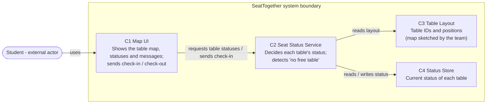

# Architecture v1 — SeatTogether

**Team:** EPITECH
**Product:** SeatTogether
**Members:** Esteve BASCUNANA (12264733), Adam LARKEM (12264692)
**Date:** 2026-09-29
**Writer:** Esteve BASCUNANA **Reviewer:** Adam LARKEM (on the pull request)
**Status:** Draft for M3. Planned structure only. No code has been written or run.

---

## 1. Input and scope

**Input source:** Our Week 4 file, `M2_story_slice.md` (stories S1 and S2).

**User task:** Find a free table in the cafeteria (story S1). Table statuses are produced by check-in/check-out (story S2).

**Scope boundary (excluded capability):** The "open to company" status and community status reporting are excluded, as in the M2 slice. They would use the same table map later, but are not part of this view.

**Requirement and acceptance-criterion IDs**

| ID | Required behavior / observable expected result |
|---|---|
| S1 | As a student arriving with a tray, I want to see which tables are free on a map, so that I can go directly to a free table. |
| S1-AC1 | Given T1 is marked free and T2 occupied, when the student opens the map, then T1 is shown as free and T2 as occupied, each with a distinct color and a text label, without tapping. |
| S1-AC2 | Given every table is marked occupied, when the student opens the map, then the message "No free table reported right now" is shown above the map. |
| S2 | As a student who has just sat down, I want to mark my table occupied and free it when I leave. (Source of the statuses; not traced in detail here.) |

**Unknowns:** how long a check-in stays valid; whether a table is tracked as a whole or seat by seat; how quickly a status change must appear for other users, which affects C2 and C4 (open questions from M2).

---

## 2. Structure diagram (logical view)



Text version (if Mermaid does not render):

```
Student ──uses──> [C1 Map UI] ──requests statuses / check-in──> [C2 Seat Status Service]
                                                                    ├──reads layout──> [C3 Table Layout]
                                                                    └──reads/writes──> [C4 Status Store]
(C1–C4 are inside the SeatTogether system boundary; the Student is outside.)
```

**Arrow legend:** A → B means A uses (calls) B. Results return to A along the same arrow; a return value does not have its own arrow.

**Components and responsibilities**

| Component | Responsibility |
|---|---|
| C1 Map UI | Displays the cafeteria map with each table's status (color + text label) and any message; lets the student check in or out. Contains no status rules. |
| C2 Seat Status Service | Combines the layout with stored statuses, applies the status rules, and returns each table's status plus a "no free table" indication. |
| C3 Table Layout | Provides the list of tables and their positions on the map. Static data built from the team's own sketch of the cafeteria. |
| C4 Status Store | Keeps the current status (free / occupied) of each table. |

These boxes are logical responsibilities. They do not imply separate servers or services; deployment has not been chosen.

---

## 3. Criterion paths

**S1-AC1 path (normal case):**
Student opens the map → C1 requests table statuses from C2 → C2 reads table positions from C3 and current statuses from C4 → C2 returns T1 = free, T2 = occupied → C1 displays T1 and T2 with distinct colors and text labels.

**S1-AC2 path (no-result case):**
Same calls as S1-AC1. The difference is inside C2: it finds no table with status free and returns the "no free table" indication with the statuses → C1 displays "No free table reported right now" above the map (tables still shown as occupied). C1 does not decide this itself.

These are planned paths, not evidence that any code has run.

---

## 4. Constraints, assumptions, unresolved rule

- **Constraint:** no official floor plan from Inha; C3 is built from the team's own sketch and photos.
- **Constraint:** the M1/M3 prototype is a clickable mockup; C2 and C4 are simulated by the facilitator during the test. This architecture describes the coded MVP that follows it.
- **Assumption:** status rules (expiry, multi-person tables) will change after the first user feedback.
- **Assumption:** students will check in (M1 assumption #2, confidence Low). If they do not, C4 contains stale data regardless of the architecture.
- **Unresolved rule:** what happens when a student checks in at a table already marked occupied (reject, accept and keep occupied, or track seats). Not decided; it would be implemented in C2.

---

## 5. Decision D1

**Decision:** Where is the status rule applied (what counts as free / occupied, and when "no free table" is reported)?

**Related IDs and the need they create:** S1-AC1 and S1-AC2 require every table's status and the "no free table" case to be determined consistently. S2 writes the statuses. The open rules from M2 (expiry, occupied-table check-in) will be added to this logic later.

**Option A:** Keep the rule in a separate Seat Status Service (C2). The UI only asks for statuses and displays them.
**Option B:** The UI reads the Status Store directly and applies the rule itself.

**Chosen option and reason:** Option A. The quality attribute that matters here is **maintainability**: our status rules are not decided yet and will change. With Option A, those changes are made in one place (C2), and the UI does not need to change as long as the interface between C1 and C2 stays the same. This follows the "implement once" and "stable interfaces" decomposition guidelines from the Week 5 lecture (Sommerville 2020, Ch. 4).

**Trade-off**
- *Benefit:* rule changes are localized in C2; the same rule can later be reused by the excluded features (community reporting, "open to company").
- *Cost:* one more component to build, and we must define and maintain the input and result format between C1 and C2. For a clickable mockup, this adds work that brings no visible benefit yet.
- *When to reconsider:* this structure targets the coded MVP (Milestone 4, Week 10); the clickable mockup does not implement C2 or C4 at all. Reconsider if the team decides not to build a coded MVP, or if the rules turn out to be trivial and stable after the prototype test.

**Assumption behind the choice:** the status rules will change after first feedback.
**Next check and evidence to look for:** when the expiry rule is decided, verify on the design that only C2 needs to change and that both criterion paths (S1-AC1, S1-AC2) still hold. This is a planned check; it has not been done.

---

## 6. Week 6 handoff

Interaction chosen for later interface/API work: **C1 Map UI → C2 Seat Status Service, "get table statuses"** (input: none or cafeteria ID; result: list of tables with ID, position, status, plus a "no free table" indication).

---

## 7. Peer review and save

- [ ] Both criteria can be traced through named responsibilities to visible results.
- [ ] Arrows are labeled; their direction and the system boundary are clear.
- [ ] D1 compares alternatives and explains a quality benefit and a real cost.
- [ ] Assumptions and planned checks are distinct from actual evidence.

**Reviewer; ambiguity found; change made (or reason no change was needed)**
Reviewer: Adam LARKEM, on the pull request for branch `docs/architecture-v1`. The reviewer explains both criterion paths, challenges D1, and records one ambiguity and the fix.
Ambiguity found and change made: TODO (Adam, from the PR review).

**Saved file/location; person who reopened and checked it**
Saved in the team repository as `docs/Architecture_v1.md` (branch `docs/architecture-v1`, merged through a pull request). Reopened and checked by: TODO (Adam, after merge).

**AI use**
Used. See AI_USAGE.md, entry 3 (2026-09-29).
