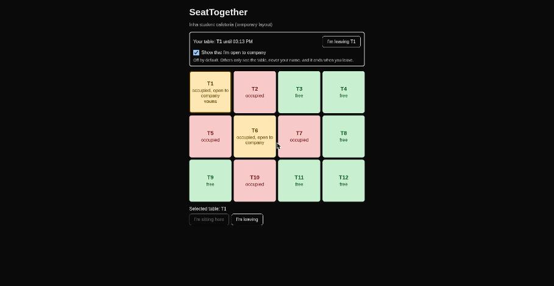

# Release candidate check (Week 13, M5)

**Date:** 2026-11-27
**Run by:** Claude Code (AI), on `main` before the tag `v1.0.0-rc1`. **Not yet re-run by a team member.**
**Environment:** Linux, Docker 29.8.2, Compose 5.5.1, Node 20.20.2 locally (image and CI: Node 22), `postgres:17-alpine`, Google Chrome.

## 1. Automated tests

`TEST_DATABASE_URL=… npm run test:coverage` against a throwaway PostgreSQL container: **70/70 passed**, 7 test files. Coverage: 92.04% of lines, 94.82% of branches.

The UI test file was run 10 times in a row after fixing a race in two tests (they read the map before it had loaded): 10/10 passed.

`npm run lint`, `npx tsc --noEmit` and `npm run build` succeeded. `npm audit --omit=dev`: 0 vulnerabilities after patching Next.js to 16.4.6.

## 2. System check of the Docker deployment

`bash scripts/compose_smoke.sh`: **9/9 passed**: health reports the PostgreSQL store, the page sends `X-Frame-Options: DENY`, check-in 201, T1 occupied, T1 still occupied after an app restart (#35), check-out 200, T1 free, check-in and check-out logged, token absent from the logs.

## 3. Main flow in a browser

On the Compose stack (port 3300), with T2, T5, T7, T10 checked in and T6 open to company through the API (sample data):

| Step | Expected | Observed |
|---|---|---|
| 1. Select T1, "I'm sitting here" | T1 occupied, "Your table: T1 until …", message with the end time | As expected |
| 2. Tick "Show that I'm open to company" | T1 shows "occupied, open to company" | As expected |
| 3. Reload the page (#34) | "Your table: T1" still shown, box still ticked, T1 marked "yours" | As expected, see screenshot below |
| 4. "I'm leaving T1" | T1 free, "Table T1 is free again. Thank you!", the "Your table" box disappears | As expected |

App logs for these steps (`docker compose logs app`): one JSON line each for `checkin` T1, `company` T1 `open: true`, `checkout` T1, all `"result":"ok"`.

**Seen during the run (not a failure):** when the "Your table" box appears above the map, the map moves down. A student who taps quickly could hit another table. Listed in [Maintenance.md](../Maintenance.md), section 2.

## What this does not show

- No real student used it (P1, #30, still to do). All data was created by us.
- No load test: the planned `autocannon` run was not executed (blocked in the AI session, see AI_USAGE entry 15).
- Checked in one desktop browser only, no phone and no screen reader.
